# PeartoFinance Project Workflow Documentation

This document provides a comprehensive analysis of the PeartoFinance project architecture, including separate workflows for each component and combined flowcharts showing how all parts work together.

---

## 📋 Project Overview

**PeartoFinance** is a full-stack finance platform consisting of:
- **Backend**: Flask REST API with SQLAlchemy ORM
- **Frontend**: Next.js 15 consumer-facing application
- **Admin Panel**: Next.js administrative dashboard

## 🗺️ Complete Project Flowchart


---

## 🗂️ Project Structure Summary

```
PeartoFinance/
├── backend/                    # Flask REST API (Python)
│   ├── app.py                  # Main application entry
│   ├── config.py               # Database & app configuration
│   ├── models/                 # SQLAlchemy models (80+ tables)
│   ├── routes/                 # API blueprints (20+ modules)
│   │   └── admin/              # Admin-specific API routes
│   ├── handlers/               # Email, utility handlers
│   └── services/               # Business logic services
│
├── frontend/                   # Consumer Web App (Next.js)
│   └── src/
│       ├── app/                # Next.js App Router pages
│       ├── components/         # React components (120+)
│       ├── services/           # API service modules
│       ├── context/            # React contexts
│       └── types/              # TypeScript interfaces
│
└── frontend-admin/             # Admin Dashboard (Next.js)
    ├── app/                    # Admin pages
    │   └── admin/              # Protected admin routes
    ├── components/             # Admin UI components
    ├── context/                # Auth & country contexts
    └── lib/                    # Admin API client
```

---

# 🔙 BACKEND WORKFLOW

## Technology Stack
| Component | Technology |
|-----------|------------|
| Framework | Flask 3.x |
| ORM | SQLAlchemy |
| Database | MySQL (PyMySQL driver) |
| Auth | JWT + bcrypt |
| CORS | Flask-CORS |

## Architecture Diagram

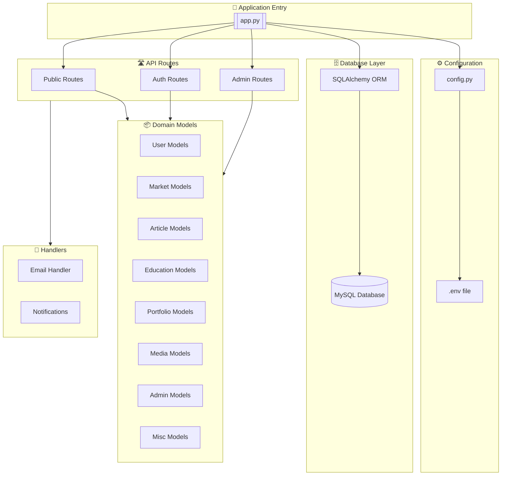

## API Routes Structure

### Public API Endpoints (`/api/`)

| Blueprint | Prefix | Purpose |
|-----------|--------|---------|
| `auth_bp` | `/api/auth` | Login, signup, password reset, Google OAuth |
| `stocks_bp` | `/api/stocks` | Stock quotes, search, history |
| `crypto_bp` | `/api/crypto` | Cryptocurrency data |
| `news_bp` | `/api/news` | News articles, RSS feeds |
| `market_bp` | `/api/market` | Market indices, commodities, movers |
| `portfolio_bp` | `/api/portfolio` | User portfolios, watchlists |
| `articles_bp` | `/api/articles` | Blog articles, posts |
| `content_bp` | `/api/content` | Dynamic content pages |
| `account_bp` | `/api/account` | User account management |
| `user_bp` | `/api/user` | User profile, settings |
| `verification_bp` | `/api/user/verification` | Email/identity verification |
| `devices_bp` | `/api/devices` | Device management, push tokens |
| `tools_bp` | `/api/tools` | Financial calculators |
| `media_bp` | `/api/media` | TV channels, radio stations |
| `education_bp` | `/api/education` | Courses, quizzes, webinars |
| `ai_bp` | `/api/ai` | AI-powered features |

### Admin API Endpoints (`/api/admin/`)

| Blueprint | Purpose |
|-----------|---------|
| `dashboard_bp` | Admin dashboard stats |
| `users_bp` | User management |
| `news_bp` | News article CRUD |
| `tools_bp` | Tool configuration |
| `content_bp` | Content management |
| `team_bp` | Team member management |
| `settings_bp` | App settings |
| `audit_bp` | Audit logs |
| `marketing_bp` | Campaigns, subscribers |
| `tasks_bp` | Background tasks |
| `support_bp` | Support tickets |
| `jobs_bp` | Job listings |
| `market_bp` | Market data management |
| `media_bp` | Media asset management |
| `education_admin_bp` | Course management |

## Database Schema Overview

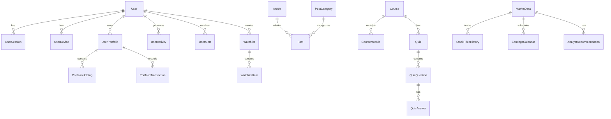

## Backend Data Flow

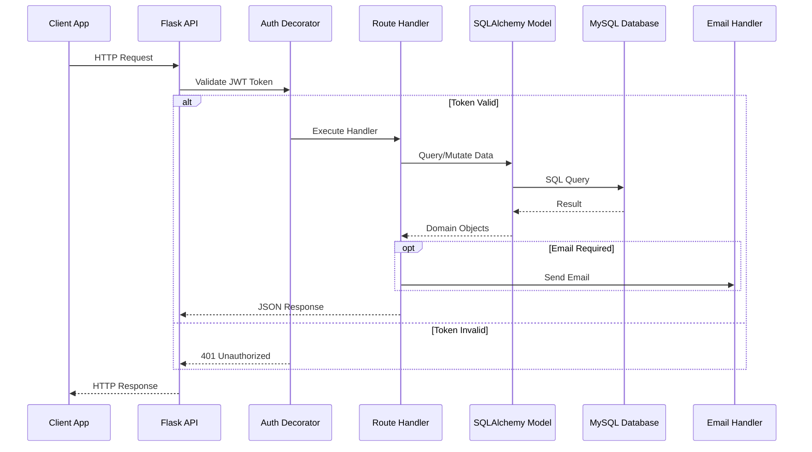

---

# 🖥️ FRONTEND WORKFLOW

## Technology Stack
| Component | Technology |
|-----------|------------|
| Framework | Next.js 15 (App Router) |
| Language | TypeScript |
| Styling | Tailwind CSS |
| Auth | Firebase + JWT |
| State | React Context |
| i18n | Custom i18n solution |

## Component Architecture

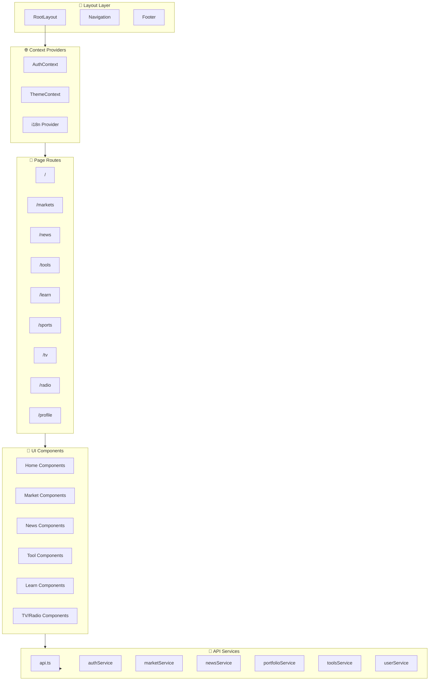

## Page Routes Structure

| Route | Description | Components |
|-------|-------------|------------|
| `/` | Homepage with market overview | DashboardWidgets, MarketOverview |
| `/markets` | Full market data view | StockTable, CryptoList, Indices |
| `/news` | News feed and articles | NewsCard, ArticleList |
| `/news/[slug]` | Individual article | ArticleContent, RelatedNews |
| `/tools` | Financial calculators grid | ToolsGrid, ToolCard |
| `/tools/[slug]` | Individual calculator | Calculator components (60+) |
| `/learn` | Educational content | CourseList, QuizComponent |
| `/sports` | Sports events | EventCard, EventModal |
| `/tv` | Live TV streams | TVPlayer, ChannelList |
| `/radio` | Radio stations | RadioPlayer, StationList |
| `/profile` | User dashboard | ProfileStats, AccountSettings |
| `/login` | Authentication | LoginForm |
| `/signup` | Registration | SignupForm |

## Frontend Services Flow

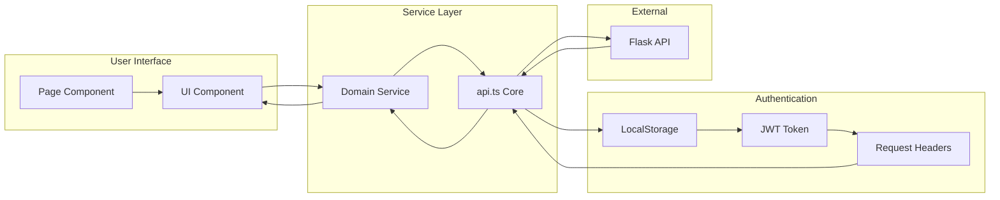

## Authentication Flow (Frontend)

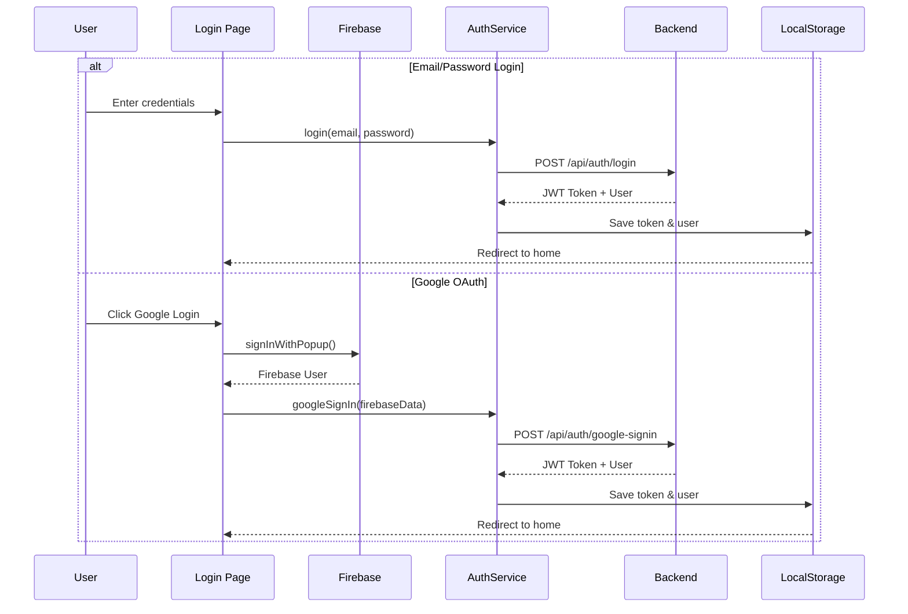

---

# 🔧 ADMIN PANEL WORKFLOW

## Technology Stack
| Component | Technology |
|-----------|------------|
| Framework | Next.js 15 (App Router) |
| Language | TypeScript |
| Auth | Secret-based (X-Admin-Secret) |
| State | React Context |
| API Client | Custom adminApi |

## Admin Panel Architecture

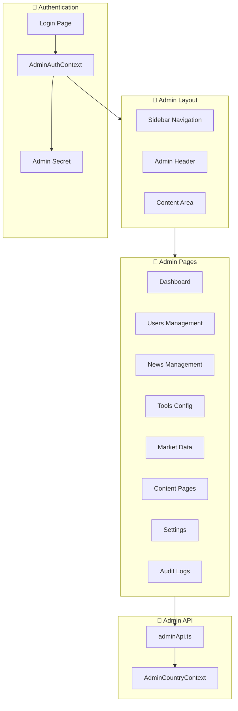

## Admin Page Routes

| Route | Purpose | Features |
|-------|---------|----------|
| `/admin` | Dashboard | Stats, activity feed |
| `/admin/users` | User management | CRUD, verification |
| `/admin/news` | News articles | Create, edit, publish |
| `/admin/tools` | Tool configuration | Enable/disable, settings |
| `/admin/market` | Market data | Indices, stocks, crypto |
| `/admin/content` | Content pages | Dynamic page management |
| `/admin/settings` | App settings | Global configuration |
| `/admin/team` | Team members | Staff management |
| `/admin/jobs` | Job listings | Career page management |
| `/admin/audit` | Audit logs | Activity tracking |
| `/admin/subscribers` | Email subscribers | Newsletter management |
| `/admin/messages` | Support messages | Customer support |
| `/admin/tv` | TV Channels | Live stream management |
| `/admin/radio` | Radio Stations | Audio stream management |
| `/admin/tasks` | Background tasks | Job scheduling |

## Admin Authentication Flow

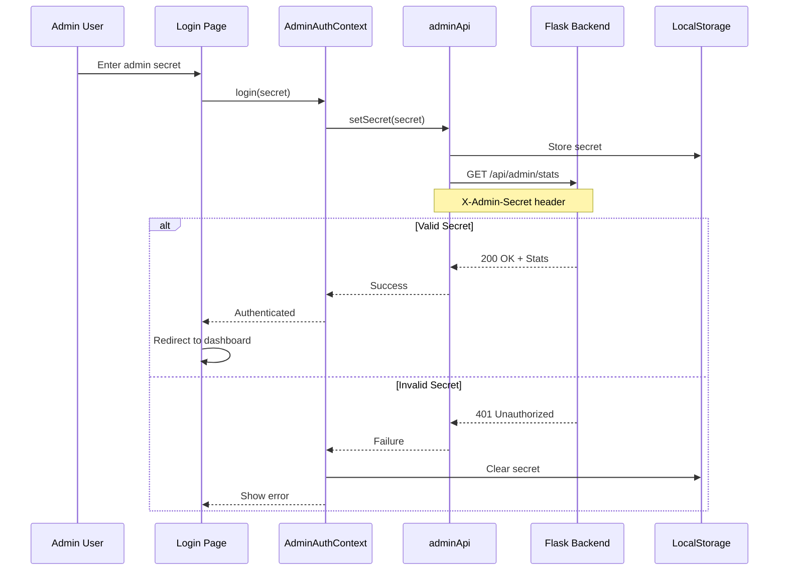

---

# 🔄 COMBINED SYSTEM WORKFLOW

## Complete System Architecture

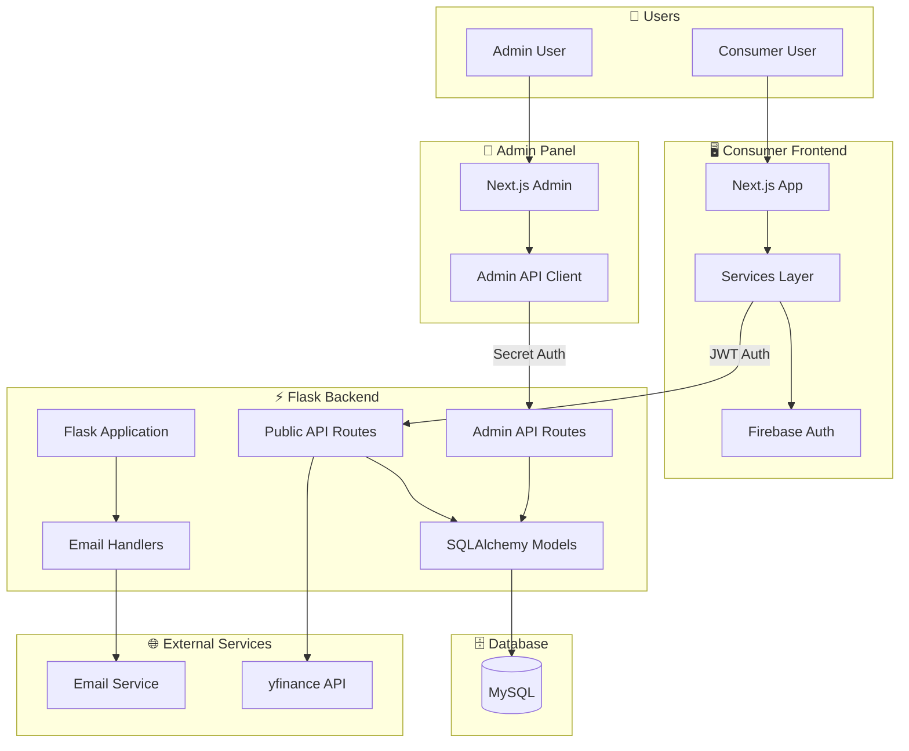

## Complete Request Flow Diagram

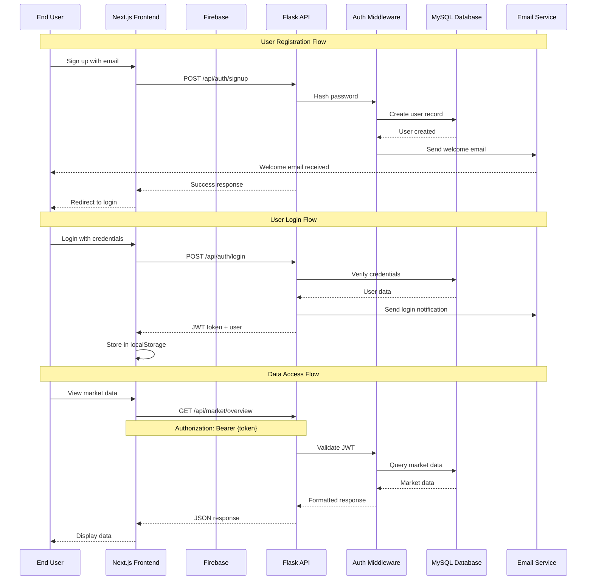

## Data Flow Between Components

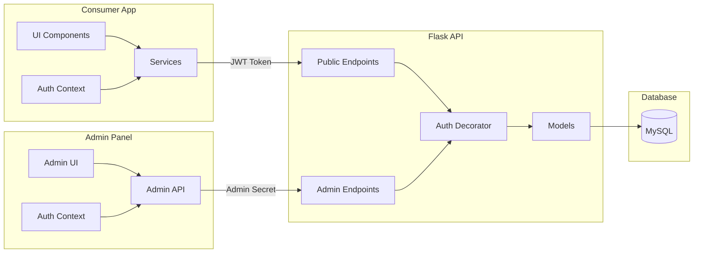

---

## 📊 Key Features Mapping

| Feature | Frontend | Backend | Admin |
|---------|----------|---------|-------|
| User Auth | ✅ Login/Signup/OAuth | ✅ JWT Generation | ✅ Secret-based |
| Market Data | ✅ Display | ✅ CRUD + External APIs | ✅ Management |
| News | ✅ Read | ✅ CRUD | ✅ Create/Edit |
| Tools | ✅ 60+ Calculators | ✅ Config Storage | ✅ Enable/Disable |
| Portfolio | ✅ View/Manage | ✅ CRUD | ❌ |
| Education | ✅ Courses/Quizzes | ✅ CRUD | ✅ Management |
| Media (TV/Radio) | ✅ Playback | ✅ Stream URLs | ✅ Management |
| Sports | ✅ Event Display | ✅ CRUD | ✅ Management |

---

## 🚀 Deployment Architecture

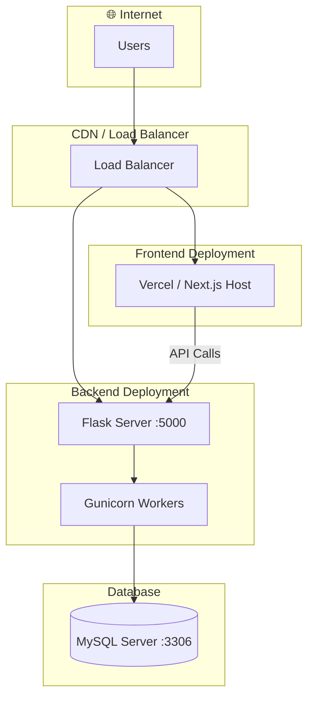

---

## 📝 Summary

### Backend
- **20+ API blueprints** serving both public and admin endpoints
- **80+ database models** covering users, market data, content, and more
- **JWT-based authentication** for public APIs
- **Secret-based authentication** for admin APIs

### Frontend
- **12+ page routes** for consumer features
- **120+ reusable components** with modular organization
- **10 service modules** abstracting API calls
- **Firebase integration** for OAuth authentication

### Admin Panel
- **15 admin sections** for comprehensive management
- **Country-based filtering** via context
- **Real-time stats** on dashboard
- **Audit logging** for all admin actions

---

> **Generated**: January 12, 2026  
> **Project**: PeartoFinance
